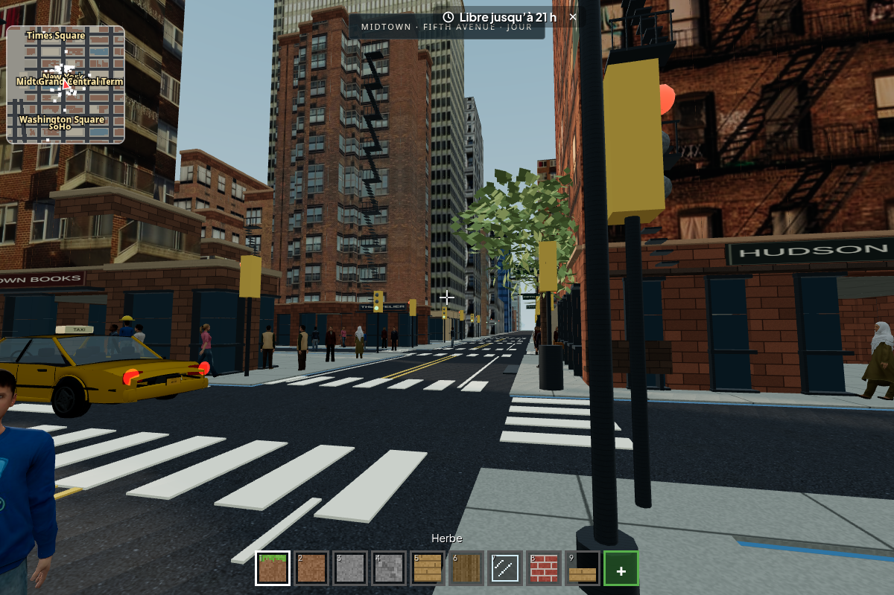
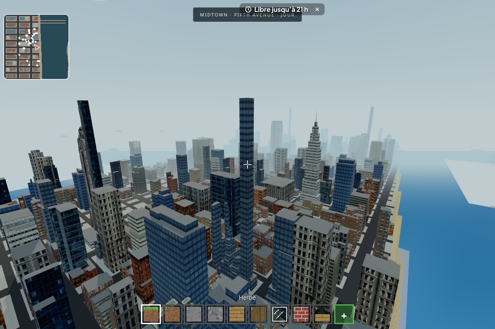
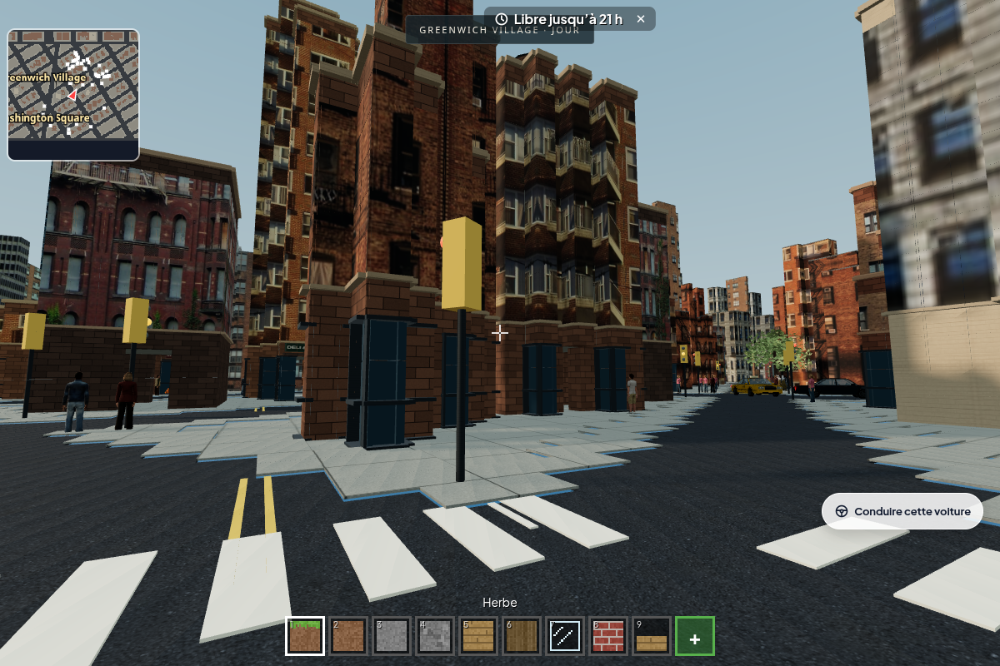
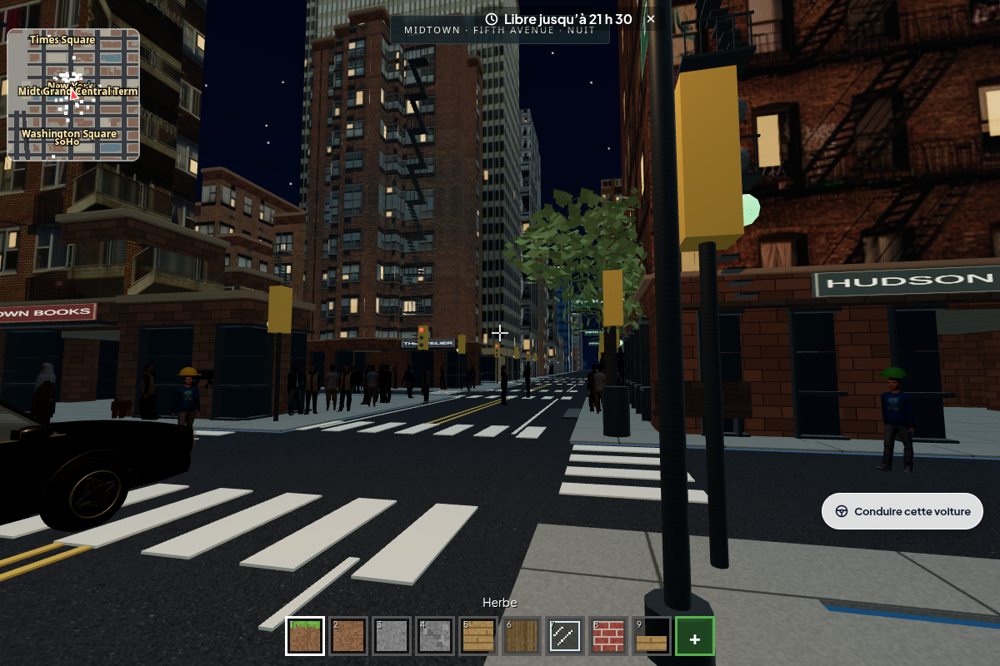

# Revue de la refonte Manhattan

Reprise de [la PR #587](https://github.com/max-pruv/minecraft/pull/587), à partir
de `6c8be9a`, avec les profils du modèle OSM fourni par Max. Les dix quartiers
périphériques, les monuments photographiques et les protections de sauvegardes
de cette PR sont conservés. Aucun déploiement n'est effectué par cette reprise.

## Résultat visible

| Midtown, à hauteur de piéton | Midtown, volumes et terrasses |
| --- | --- |
|  |  |

| Greenwich Village | Fenêtres nocturnes corrigées |
| --- | --- |
|  |  |

Les cours et les retraits viennent de l'atlas OSM. Les photographies proviennent
du paquet New York Buildings déjà converti dans la PR #587. Le masque nocturne
ne confond plus ombres d'escaliers et fenêtres, et les dix variantes de façade
s'allument. Les captures de Brooklyn et de la Liberté ont également été inspectées.

## Données et échelle

- Atlas : **879 profils**, **170 535 octets**, issu du modèle de 306 630 456 octets.
- Île : **1 640 immeubles OSM**, huit familles architecturales ; le plan complet
  conserve aussi les bâtiments des dix quartiers périphériques de la PR.
- **79 circuits** sur l'île, **48 circuits** périphériques.
- Étages de trois unités ; personnage de 1,8 unité ; gabarits des véhicules
  conservés. La fonction de compression des hauteurs est monotone.
- **10 209 rectangles** fusionnent les colonnes du lointain, en préservant les
  cours. Le champ de collision utilise 172 592 octets de valeurs de hauteur.

Il s'agit d'une adaptation au plan jouable, pas d'une reconstruction à l'adresse
cadastrale exacte. Les limites et la régénération sont détaillées dans
[manhattan-osm.md](manhattan-osm.md). Les [deux ponts fournis](manhattan-ponts-sources.md)
ont été inspectés, mais leurs scans ne sont pas intégrés à cette livraison.

## Vérification

Environnement : Node.js 24.19, Chromium 154, SwiftShader, suites exécutées
successivement. Le rendu logiciel sert à vérifier le comportement et l'image ;
il ne mesure pas les performances d'un iPad physique.

- Contrats d'architecture : **7/7 passent** (provenance, quartiers, diversité,
  hauteurs, cours et collision/lointain, rues libres, cache hors ligne).
- Extraction répétée : atlas identique octet pour octet avec le cache de source
  contrôlé par SHA-256.
- Six vues inspectées, puis nouvelle capture nocturne après correction des
  masques ; aucune erreur JavaScript ou WebGL relevée pendant les captures.
- Fumée : **aucun échec** ; tous les 142 modules résolvent leurs imports et
  figurent dans le cache hors ligne.
- Suite Manhattan : **aucun échec**, terminée en 7 min 59 s via le portail
  (`npm test -- --tranche=4/17`). Les collisions, la destruction visible,
  la conduite tactile, les sauvegardes, les deux clients et la PWA hors ligne passent.
- Portail complet : **validation en cours**. Le verdict final sera inscrit
  ici après la fin des autres suites.

Les contrôles hérités ont été adaptés au périmètre réel : les sondes de terrain
se trouvent au-delà des dix nouvelles zones et de leur talus, et le contrat des
feux vérifie les 79 circuits de l'île. La protection des frontières et des
constructions des banlieues reste contrôlée par `plafond.js`. Le test de marche
choisit une façade réelle après un trajet libre et compte des images distinctes,
afin qu'une attente de rendu ou un lampadaire ne puisse simuler un arrêt au mur.

Pour reproduire les captures :

```sh
CHROMIUM=/usr/bin/chromium node tests/sonde-captures-osm.cjs /tmp/manhattan-osm
# Une vue seule :
CHROMIUM=/usr/bin/chromium node tests/sonde-captures-osm.cjs /tmp/manhattan-osm midtown-nuit
```

La sonde borne son attente à deux minutes par vue ; le rendu logiciel peut
encore préparer des secteurs hors champ à cette borne. Ses compteurs de triangles
et d'appels de rendu ne sont pas un benchmark comparable aux captures anciennes.

Limites héritées de la PR : les quartiers périphériques n'ont pas encore le
réseau de feux de Manhattan ; les passants sont moins présents dans les zones
éloignées. Le rendu et les rues restent stylisés et voxelisés.
