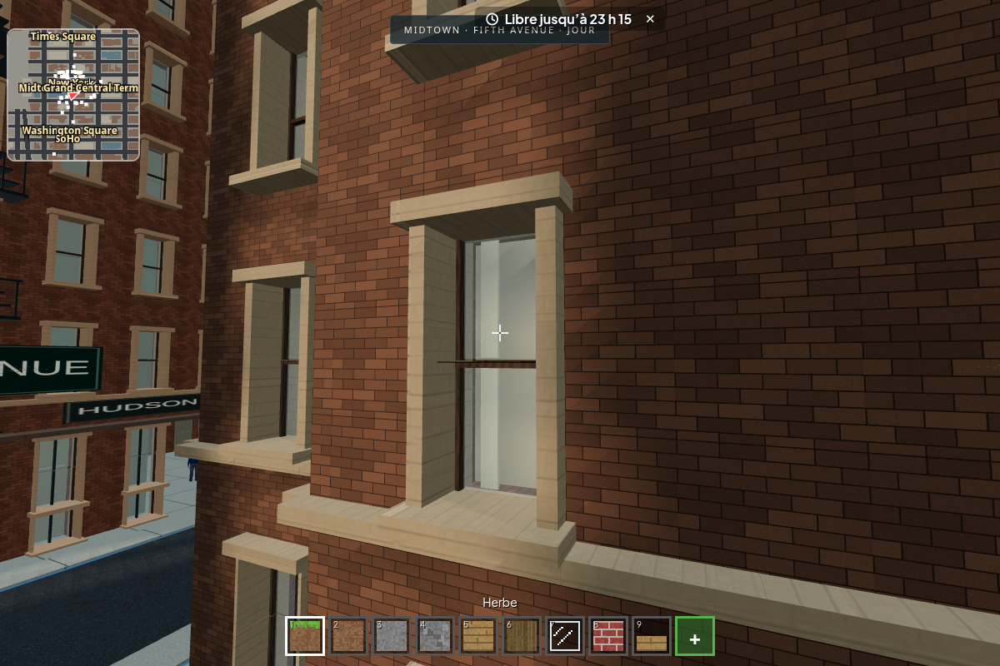

# Revue de la refonte Manhattan

Reprise de [la PR #587](https://github.com/max-pruv/minecraft/pull/587), à partir
de `6c8be9a`, avec les profils du modèle OSM fourni par Max. Les dix quartiers
périphériques, les monuments photographiques et les protections de sauvegardes
de cette PR sont conservés dans la v583. La v585 ajoute les façades en relief
décrites ici, sur la base de main `f1482ef`.

## Résultat visible : architecture en relief

Les immeubles OSM utilisent des embrasures, vitrages transparents, fonds de
fenêtres, châssis, appuis, corniches et ferronneries en géométrie. Les briques
sont à l'échelle du personnage ; la pierre et le bois ont leurs propres
textures et microreliefs. Les fenêtres restent géométriques au loin.
Les angles étroits gardent un trumeau plein, et les escaliers de secours se
placent devant des baies existantes. Le dernier étage garde des fenêtres de
même hauteur que les étages inférieurs.



| Midtown, à hauteur de piéton | Midtown, volumes et terrasses |
| --- | --- |
|  |  |

| Greenwich Village | Fenêtres nocturnes corrigées |
| --- | --- |
|  |  |

Les cours et les retraits viennent de l'atlas OSM. La lumière nocturne des
immeubles OSM vient des fonds derrière les vitres. Les photographies du paquet
New York Buildings restent utilisées par les modèles hérités ; leurs masques
nocturnes suivent les baies et non les ombres d'escaliers.

Les cinq captures de cette galerie montrent la v585, après la dernière passe
sur les travées : aucune erreur JavaScript, HTTP ou WebGL. Les
[mesures de capture](manhattan-osm-captures/mesures-v585.json) gardent les positions,
les durées et les compteurs. Le gros plan montre le vitrage en retrait, les
châssis et les appuis vus de biais ; la vue nocturne montre les fonds éclairés.
La vue Village expose aussi le défaut restant : les petits pans des contours
en escalier ont peu de baies et découpent les corniches. Il reste à reprendre
ces contours pour atteindre la fidélité demandée.

La revue tactile de la v585 comporte **huit captures**, iPhone/iPad,
à pied et au volant, jour/nuit, sans échec de préparation ou de capture.
Les deux préparations de conduite confirment `auVolant: true`. Les images
sont archivées en JPEG à leur taille d’origine dans
[`revue-ecran/v585-facades/`](revue-ecran/v585-facades/), avec les liens et
la commande de reproduction dans [la revue d’écran](revue-ecran.md).

## Données et échelle

- Atlas : **879 profils**, **170 535 octets**, issu du modèle de 306 630 456 octets.
- Île : **1 640 immeubles OSM**, huit familles architecturales ; le plan complet
  conserve aussi les bâtiments des dix quartiers périphériques de la PR.
- **79 circuits** sur l'île, **48 circuits** périphériques.
- Étages de trois unités ; personnage de 1,8 unité ; gabarits des véhicules
  conservés. La fonction de compression des hauteurs est monotone.
- **10 209 rectangles** fusionnent les colonnes du lointain, en préservant les
  cours. Le champ de collision utilise 172 592 octets de valeurs de hauteur.

Il s'agit d'une adaptation au plan jouable, pas d'une reconstruction à l'adresse
cadastrale exacte. Les limites et la régénération sont détaillées dans
[manhattan-osm.md](manhattan-osm.md). Les [deux ponts fournis](manhattan-ponts-sources.md)
ont été inspectés, mais leurs scans ne sont pas intégrés à cette livraison.

## Sauvegardes : correction avant publication

La reprise sur main a révélé une régression : sur vingt anciens toits portant
un bloc sauvegardé, dix-neuf perdaient leur support avec les volumes OSM.
Les volumes v582 correspondants sont maintenant conservés en entier, dans
le rendu proche, le lointain et la collision ; les nouveaux immeubles qui
les chevaucheraient s'effacent. Les autres quartiers gardent la refonte OSM.
Le nouveau contrat vérifie quatre anciens toits, le transfert de leur journal,
l'invalidation d'un morceau déjà généré et le maintien des volumes nouveaux
pour les éditions postérieures à la migration. La sonde des vingt toits ne
présente plus d'écart après correction.

## Vérification

Environnement : Node.js 24.19, Chromium 154, SwiftShader, suites exécutées
successivement. Le rendu logiciel sert à vérifier le comportement et l'image ;
il ne mesure pas les performances d'un iPad physique.

- Contrats d'architecture : **8/8 passent** (provenance, quartiers, diversité,
  hauteurs, cours et collision/lointain, rues libres, cache hors ligne).
- Extraction répétée : atlas identique octet pour octet avec le cache de source
  contrôlé par SHA-256.
- Contrôle du relief : six baies de maillages affichés ont **47,5 cm entre le
  vitrage et le fond**, avec des tableaux saillants. Les douze immeubles OSM
  examinés n'emploient aucune photo de façade. L'ancien rendu de `b77ac64`, servi
  à la même sonde, échoue avec zéro baie profonde et douze façades photographiques.
- Fumée : **aucun échec** ; tous les 144 modules résolvent leurs imports et
  figurent dans le cache hors ligne.
- Passe Manhattan après recalage des travées, avant la reprise finale de main
  et le numéro v585 : **aucun échec**, terminée en **10 min 34 s** via
  `npm test -- --tranche=4/17`, après recalage des travées. Les contrôles de
  relief, collisions, destruction, conduite tactile, sauvegardes, partage des
  blocs, absence d’erreurs JavaScript/WebGL et PWA hors ligne passent.
- Une passe précédente de 10 min 42 s avait signalé PeerJS `Aborting!` / `ID is
  taken` dans le contrôle des deux clients, tandis que les échanges réussissaient.
  Cette intermittence déjà répertoriée reste consignée dans `TASKS.md` ; aucun
  filtre d’erreur ni changement réseau n’a été ajouté pour la masquer.
- Passe complémentaire sur la v585 complète : fumée verte et `carte.js` verte
  en **4 min 05 s**. `manhattan.js` termine en **9 min 54 s** avec **un échec** :
  le bloc posé par l’hôte n’est pas reçu par l’invité en 30 secondes
  (`tests/manhattan.js:1103`). Les contrôles locaux, dont le nouveau relief,
  passent ; les contrôles multijoueurs et hors ligne situés après ce délai ne
  sont pas atteints dans cette passe. Le même symptôme apparaît dans le suivi
  v245–v246 du banc ; il n’est pas transformé en succès ici.
- La première passe `maj.js` a relevé deux témoins déjà déclarés du loader et
  une puce v585 trop longue. Le portail a été arrêté avant modification des
  sources ; la puce est raccourcie à huit mots, puis les deux suites restantes
  sont reprises séquentiellement via `--tranche=3/17` (mise à jour) et
  `--tranche=1/17` (conduite). Aucun changement de géométrie depuis les captures.
- Le relevé du portail complet de la v583 est conservé plus bas ; il ne constitue
  pas une validation globale des nouvelles façades de la v585.


Les contrôles hérités ont été adaptés au périmètre réel : les sondes de terrain
se trouvent au-delà des dix nouvelles zones et de leur talus, et le contrat des
feux vérifie les 79 circuits de l'île. La protection des frontières et des
constructions des banlieues reste contrôlée par `plafond.js`. Le test de marche
choisit une façade réelle après un trajet libre et compte des images distinctes,
afin qu'une attente de rendu ou un lampadaire ne puisse simuler un arrêt au mur.

Pour reproduire les captures :

```sh
CHROMIUM=/usr/bin/chromium node tests/sonde-captures-osm.cjs /tmp/manhattan-osm
# Une vue seule :
CHROMIUM=/usr/bin/chromium node tests/sonde-captures-osm.cjs /tmp/manhattan-osm midtown-nuit
```

La sonde attend des images de jeu distinctes après chaque déplacement, puis
rafraîchit les ombres avant la capture. Elle borne son attente à deux minutes
par vue ; le rendu logiciel peut
encore préparer des secteurs hors champ à cette borne. Ses compteurs de triangles
et d'appels de rendu ne sont pas un benchmark comparable aux captures anciennes.

Limites : les quartiers périphériques n'ont pas encore le
réseau de feux de Manhattan ; les passants sont moins présents dans les zones
éloignées. Le rendu, les contours des empreintes et les rues restent stylisés
et voxelisés. Les pans étroits des empreintes diagonales restent souvent
aveugles, avec des corniches fragmentées (défaut 42 de la revue). Le relief
des façades est réel ; la fidélité globale d'un GTA
récent n'est pas atteinte.

Revue mobile historique de la v583, après intégration de main et correction
des supports : huit
captures Midtown/Brooklyn, jour et nuit, iPhone et iPad, dans
`docs/revue-ecran/v583-new-york/`. Les limites observées (feuillage anguleux,
fin de rue vide) figurent au relevé 40–41 de `docs/revue-ecran.md`.

## Contrôles de la v583, avant les façades en relief

Sur `bfba5e6`, le [portail complet](https://github.com/max-pruv/minecraft/actions/runs/41320845365)
est lancé en quatre tranches. Les suites `manhattan`, `plafond`, `sauvegarde`,
`hote`, `maj`, `realisme`, `carteMonde`, `degats`, `washington`, `reglages`,
`metro`, `parent` et `visio` passent. Les contrats d'architecture passent à 8/8.
Le portail n'est pas entièrement vert : le relevé des échecs est dans `TASKS.md`.

La [référence publiée](https://github.com/max-pruv/minecraft/actions/runs/41317404967)
utilise `beb6f43`, dont l'arbre git est identique à `main` v582 (`7cb7a4b`).
Elle échoue aussi sur des contrôles déjà déclarés du réseau, de la conduite
et du loader. Ce constat n'explique pas automatiquement un échec de la branche :
chaque témoin est rapproché des doubles mesures déjà inscrites dans `TASKS.md`.

La sonde `node tests/sonde-support-osm.cjs capture.png` joue un vrai journal
antérieur à la migration, pose le joueur sur un toit v582 conservé, puis mesure
sa géométrie rendue par lancer de rayon. Résultat : support à y=57, construction
à y=58, joueur posé à 59,0001, toit dessiné à 57,999999, sans erreur JavaScript.
[Capture du toit conservé](revue-ecran/v583-new-york/support-ancien-toit.png).

Le témoin de terrasse corrigé a été rejoué seul, successivement sur la référence
v582 et sur New York :

| Version | Résultat dans le jeu | Verdict strict |
| --- | --- | --- |
| main v582 | terrasse cassée, 14,92 blocs parcourus ; deux autres sites écartés pour gêne par voiture | passe |
| New York v583 | terrasse intacte, arrêt à 3,04 blocs, 4,96 blocs parcourus, contact mobilier | passe |

Aucune erreur JavaScript. Commande : `node tests/sonde-terrasse.cjs /chemin/du/jeu`.
La sonde reprend la fonction exacte du test `parishd.js`, sans remplacer le
moteur de conduite ni sa détection des obstacles.

Les quatre tranches du portail `41320845365` sont terminées : **quatre échecs de
tranche**, avec dix témoins de conduite, trois de réseau, deux de carte et le
cas café ci-dessus. Tous sont détaillés dans `TASKS.md`, avec les références
aux mesures antérieures ; le café est corrigé et validé séparément. Aucun de
ces résultats n'est présenté comme un portail intégralement vert.

Passe finale : les deux dates de migration sont rafraîchies à `2026-11-01T16:28:43Z`.
Les huit contrats sont rejoués après ce changement. Le seul autre changement
de code depuis la tête testée est le filtre du témoin café ; il ne change
pas le jeu. Les ajouts documentaires et sondes ne modifient pas le moteur.
Le nouveau portail déclenché par ce dernier commit peut encore tourner au
moment de la fusion : les quatre tranches complètes déjà examinées et les
contrôles ciblés ci-dessus portent la validation, sans attendre une répétition
complète pour une date et un filtre de test.
